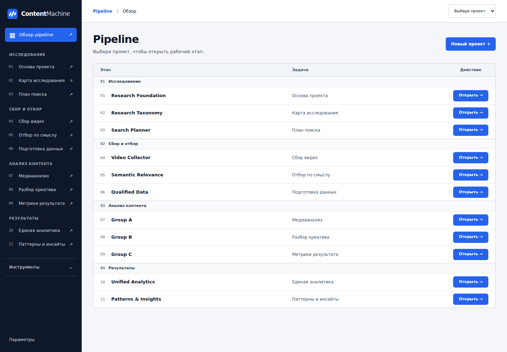
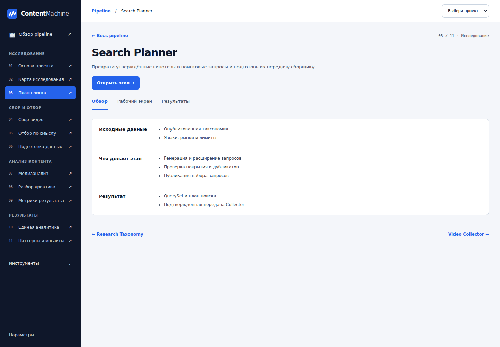

# ContentMachine · новый интерфейс pipeline

Ветка: `design/pipeline-workspace-20261029`.
База: `main` @ `a5bcd3281146f2a88a5712e544d36132f985a4fa`.

Контрастная тёмная навигация, белые рабочие поверхности и ярко-синие действия. Локальные системные шрифты. Главная страница теперь показывает исследование целиком, а инструменты загрузки доступны в отдельном разделе меню.

## Упрощение 2026-10-30

- [x] ~~Убрать баннер, орбиты, лозунги, декоративные счётчики и дублирующие блоки главной страницы.~~
- [x] ~~Заменить пастельную палитру контрастными нейтральными цветами и насыщенным синим акцентом.~~
- [x] ~~Оставить на главной выбор проекта, создание проекта и компактную таблицу 11 этапов.~~
- [x] ~~Открывать рабочие экраны одним нажатием из таблицы и бокового меню.~~
- [x] ~~Убрать пустые карточки метрик; показывать Group C только после подтверждённого ответа.~~
- [x] ~~Свернуть справку по показателям и убрать промежуточные экраны «Продолжить».~~

Контраст текста основных кнопок и меню проверен в Chromium: минимум 4,5:1. Отказ от перехода при несохранённой работе, контекст проекта и отсутствие платных запусков при навигации сохранены.

## Выполнено

- [x] ~~Общий дизайн: типографика, поверхности, формы, действия, состояния и адаптивная навигация.~~
- [x] ~~Главная страница pipeline с 11 этапами, четырьмя блоками и выбором реального проекта.~~
- [x] ~~Страницы этапов: вход → работа → выход, результаты, предыдущий и следующий этап, прямые ссылки.~~
- [x] ~~Переходы в существующие проекты, RTB Deep V2, Search Planner, Video Collector, SRE и QDP.~~
- [x] ~~Предметные экраны Group A, Group B, Group C, Unified Analytics и Patterns & Insights.~~
- [x] ~~Сохранение выбранного проекта, отклонение запоздавших ответов и существующих предупреждений о несохранённой работе.~~
- [x] ~~Мобильное меню, клавиатурная навигация, состояния загрузки, отсутствия данных и ошибки.~~
- [x] ~~Проверки и визуальный просмотр в Chromium на широком и узком экране.~~

## Как открыть

```powershell
cd C:\ContentMachine
git fetch origin
git switch design/pipeline-workspace-20261029
git pull --ff-only origin design/pipeline-workspace-20261029
python app.py
```

Открой `http://127.0.0.1:8765/`. Стартовая страница — обзор pipeline. В верхнем меню выбери проект, затем любой этап слева. Кнопка «Открыть» и боковое меню сразу открывают рабочий экран выбранного проекта. Пояснения доступны в обзоре этапа.

Прямые маршруты: `/#pipeline`, `/#stage/search`, `/#stage/search/work`, `/#stage/qdp/results`, `/#stage/group-a/work`, `/#stage/insights/work`.

## Данные и фактические ограничения

Это изменение интерфейса, а не слияние независимых веток модулей. В этой базе `main` нет Group B/C, UAE и PIE. Group A имеет отдельный opt-in HTTP facade, который не подключён в стандартном `app.py`. Для этих пяти этапов добавлены полноценные экраны просмотра и GET-адаптеры к их существующим контрактам. Пока соответствующий backend не подключён, экран показывает недоступность данных. Создание запусков этих модулей здесь не добавляется.

Метрики не заполняются примерными значениями. Просмотр этапа не означает его выполнение. Group C показывает числовые строки только для актуального результата с совпадающими проектом, видео, версией и исходной шкалой. PIE показывает только разрешённые предварительные метаданные паттернов; текст инсайтов не раскрывается и причинность не приписывается.

Навигация не подтверждает бюджеты, не запускает платную обработку и не снимает существующие ограничения модулей. Формулы, SQL, worker и provider code не менялись.

## Проверено

- 45 Node UI/DOM/контрактных тестов: PASS (включая 40 существующих).
- Video Collector operator UI: 2 теста PASS.
- Projects: 14 PASS, 1 SKIP — PostgreSQL-проверка требует `CM_TEST_PG_DSN`.
- Синтаксис изменённых JS, Python compile, CSS parsing и `git diff --check`: PASS.
- Chromium: 13 групп проверок, реальные static endpoints/Host guard; все маршруты, контекст проекта, отказ при несохранённой работе, недоступный backend, меню на ширине 390px, отсутствие uncaught JS errors и POST/PATCH/DELETE при просмотре.

Браузерный прогон запускает настоящий HTTP Handler без workers. Операционные API для сценариев с проектами подменены тестовыми ответами **только внутри теста**. Настоящий PostgreSQL и весь processing pipeline в этом прогоне не проверялись. GitHub Actions не запускались вручную; commit помечен `[skip ci]`.

Повторный browser QA: установить Playwright отдельно и выполнить `node scripts/qa_workspace_browser.cjs`. При необходимости `CM_QA_CHROMIUM` задаёт путь к установленному Chromium; `CM_QA_OUTPUT` — каталог скриншотов и отчёта.

## Изображения

Главная страница без тестовых проектов:



Страница Search Planner:


